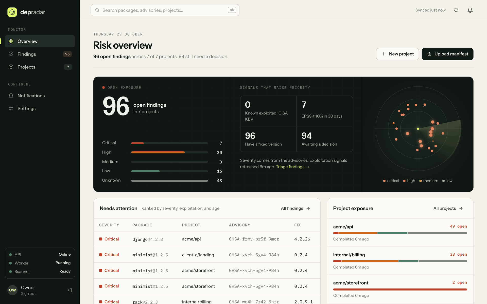
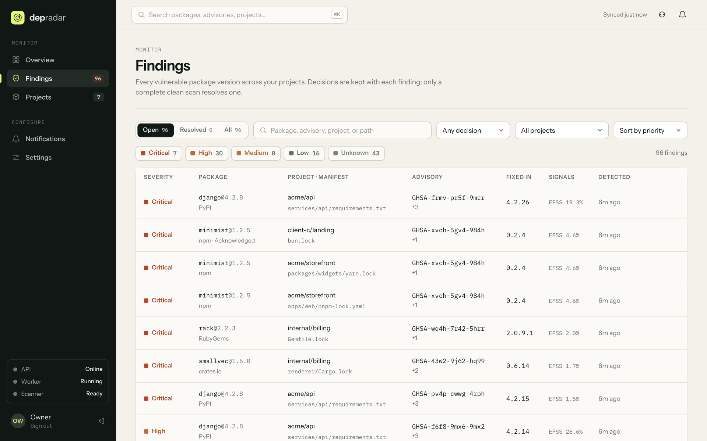
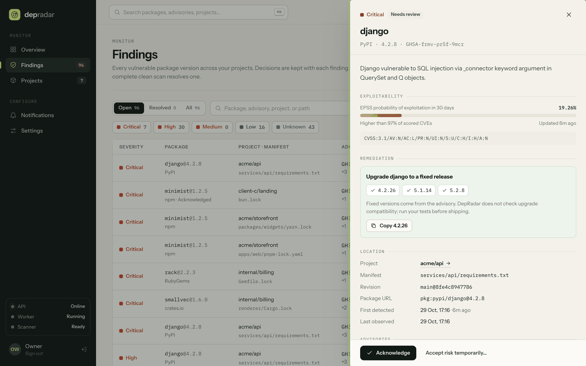
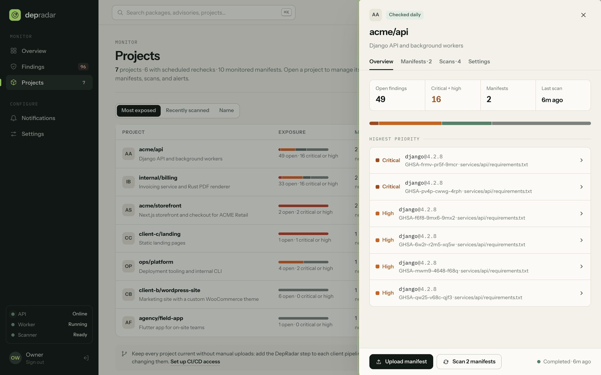
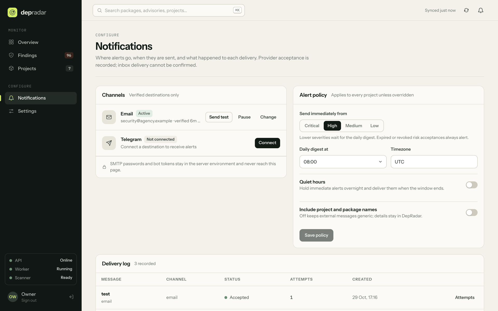
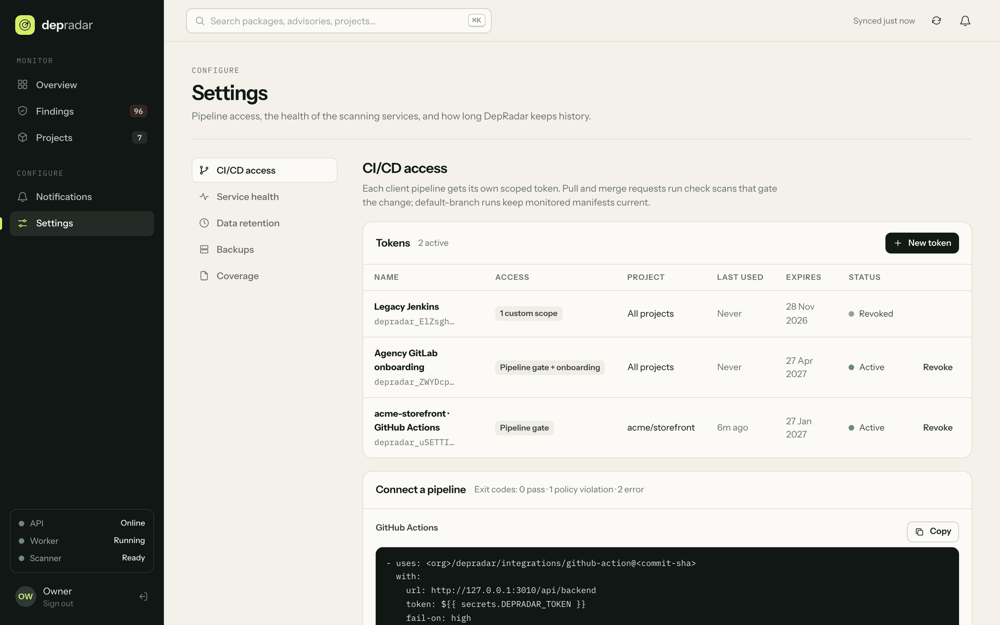

# DepRadar

Self-hosted dependency vulnerability monitoring and CI/CD gating for every project an agency
maintains.

DepRadar is implemented across a FastAPI backend and Next.js interface: project and inventory
monitoring, isolated OSV scans, finding workflow, SMTP/Telegram delivery, quiet hours and
per-project alert thresholds, EPSS/KEV enrichment, delivery attempt history, service health,
retention, and verified backup/restore. Pipelines integrate through scoped API tokens, a
standard-library client, a GitHub Action, and a GitLab template: default-branch pipelines keep
monitored inventories current, and pull/merge request pipelines are gated without touching
monitored state. One owner account administers the installation; team accounts are not built yet.
Uploading an inventory records what was submitted; rechecking it does not refresh source code or
prove deployed state.

## Screenshots

Captured from a demo installation with fictional client projects, real OSV-Scanner results, and
live CISA KEV and FIRST EPSS data.



| Findings across every project | Finding detail with fix versions and EPSS |
| --- | --- |
|  |  |
| **Project detail** | **Alert channels and policy** |
|  |  |



## Run with Docker Compose

Requirements: Docker with a running daemon and Compose, plus network access for image/package
downloads and OSV queries. From the repository root, generate local credentials:

```sh
python3 - <<'PY'
import secrets
from pathlib import Path
with Path('.env').open('x') as file:
    file.write('POSTGRES_PASSWORD=' + secrets.token_hex(24) + '\n')
    file.write('DEPRADAR_BOOTSTRAP_TOKEN=' + secrets.token_hex(32) + '\n')
    file.write('DEPRADAR_ALLOWED_ORIGIN=http://localhost:8000\n')
    file.write('DEPRADAR_SECURE_COOKIES=false\n')
Path('.env').chmod(0o600)
PY
docker compose up --build
```

The credential command refuses to overwrite an existing `.env`. Its hex passwords avoid
database-URL escaping problems. Keep `.env` private.

Compose starts PostgreSQL, applies Alembic migrations, then starts the API and worker.
The scanner binary is pinned to OSV-Scanner 2.7.0 with architecture-specific SHA-256 verification.
Its container has no application credentials, database network access, host mounts, or published port.
Input is copied into a temporary directory; package resolution and call analysis are disabled.

- If another local stack already uses port 8000, set `DEPRADAR_API_PORT` in `.env`, or prefix the
  command, as in `DEPRADAR_API_PORT=8100 docker compose up --build -d`.
- API documentation: <http://localhost:8000/docs>
- Liveness: <http://localhost:8000/health/live>
- Database/schema readiness: <http://localhost:8000/health/ready>
- Stop services: `docker compose down` (data volumes remain).
- Inspect failures: `docker compose logs worker scanner`.

Initialize the sole owner interactively after startup:

```sh
docker compose exec api depradar setup-owner
```

The password prompt is hidden and asks for confirmation. Setup refuses to replace an existing owner.

The API binds to localhost. Use HTTPS or a private network for remote access, retain owner
authentication, set the exact allowed browser origin, and enable secure cookies with HTTPS.
Keep the scanner private; it is an internal worker service, not a public API.

## Try the complete API flow

From `backend/`, install dependencies and run the interactive example:

```sh
uv sync
uv run python examples/scan_project.py
```

The example asks for the owner password and, on first initialization, the bootstrap token
from the root `.env`. It creates a project, uploads the supplied example lockfile, polls its
scan, and prints findings. Credentials and session cookies are kept in memory.
The example contains a deliberately vulnerable package for detection; do not install it.

For other API clients:

1. `POST /api/auth/bootstrap` with JSON `password` (12–128 characters) and
   `X-Bootstrap-Token` initializes the sole owner. Subsequent setup attempts return 409.
2. `POST /api/auth/login` with JSON `password` sets an HttpOnly session cookie and returns
   `csrf_token`. Retain that cookie and send `X-CSRF-Token` on authenticated mutations.
3. `POST /api/projects` with `{"name":"My project","description":""}` creates a project.
4. `POST /api/projects/{id}/inventories?filename=package-lock.json` accepts the **raw file
   bytes**, not multipart or a JSON wrapper. Maximum: 10 MiB. It returns inventory and scan IDs.
5. Poll `GET /api/scans/{id}`; inspect `GET /api/projects/{id}/findings` and `GET /api/jobs`.
6. `POST /api/inventories/{id}/scans` queues a vulnerability recheck of that stored inventory.

Project, scan, finding, and job lists support `limit`/`offset`. Finding lists also accept
`status=open` or `status=resolved`. `GET /api/auth/me` returns the current session's CSRF token.
`POST /api/auth/logout` revokes the current session.

## Local backend development

Use Python 3.12–3.14 and uv. Copy `backend/.env.example` to `backend/.env`, configure a private
PostgreSQL instance and scanner service, then run these commands from `backend/`:

```sh
uv sync
uv run alembic upgrade head
uv run uvicorn depradar.interfaces.http.app:app --reload
```

Run `uv run depradar-worker` separately. Use `uv run depradar reset-password` for interactive
owner password recovery; it revokes all sessions. In Compose, use
`docker compose exec api depradar reset-password`.

The API never creates tables automatically. Migrations are explicit; the current head is `0004`.
Stop old API/worker processes before upgrading, run migrations, then restart. Direct dependencies
and the scanner release are pinned; `backend/uv.lock` records the resolved Python dependencies.

## Verification

From `backend/`:

```sh
uv run ruff check .
uv run ruff format --check .
uv run mypy src
uv run pytest -q
```

The default suite uses SQLite for fast API/lifecycle checks and process contract doubles;
it does not claim to validate PostgreSQL locking or real OSV matching. Set
`DEPRADAR_TEST_DATABASE_URL` to a disposable PostgreSQL database to run the same API tests
against PostgreSQL plus concurrent-claim and migration up/down checks. Tests create and
remove randomly named schemas and require schema-creation privileges. The included GitHub
Actions workflow is configured to run these PostgreSQL checks.

To run the optional real scanner test, temporarily start a loopback-only scanner:

```sh
docker compose run --rm -p 127.0.0.1:8001:8001 scanner
```

Then, from `backend/` in another terminal:

```sh
DEPRADAR_LIVE_SCANNER_URL=http://localhost:8001 uv run pytest tests/test_live_scanner.py -q
```

On 29 October 2026 the isolated Docker integration stack ran on macOS arm64 (Docker 29.7) with
migration head `0004`: **112 tests passed, no skips, exit code 0**. That run covered PostgreSQL
17.11, real OSV-Scanner 2.7.0, captured SMTP, the Telegram protocol fixture, scheduled
monitoring, finding decisions, deletion, migration round-trips, backup restore drills, scoped
tokens, CI uploads, check-mode gates, and a live SARIF report. Every supported manifest format was
also scanned through the real scanner service and detected its fixture's known advisory. Ruff,
mypy, frontend lint, and the production frontend build pass.

Starlette's HTTPX TestClient deprecation warning remains. The logged duplicate project-name
constraint error is expected coverage of duplicate-name rejection. Live delivery to an external mailbox or an actual
Telegram account still requires configuring and verifying the owner's own destinations.

Run the complete isolated integration stack from the repository root:

```sh
docker compose -f compose.verify.yaml up --build --abort-on-container-exit --exit-code-from tests
```

This uses real PostgreSQL and OSV-Scanner, SMTP capture, and a local Telegram protocol fixture.
It performs a PostgreSQL backup restore drill as part of the complete flow. See
[backup and verification instructions](docs/BACKUPS.md) for cleanup and exact limits.

## CI/CD integration

Create a token in Settings → **CI/CD pipelines**, store it as the `DEPRADAR_TOKEN` secret, and run
the gate from any pipeline with Python 3.9+:

```sh
curl -fsSL "$DEPRADAR_URL/api/ci/client.py" -o depradar_ci.py
python3 -I depradar_ci.py scan --fail-on high --sarif depradar.sarif
```

GitHub Actions use [`integrations/github-action`](integrations/github-action/action.yml), and
GitLab includes [`integrations/gitlab/depradar.gitlab-ci.yml`](integrations/gitlab/depradar.gitlab-ci.yml).
Gates honor accepted risk, can fail on severity, CISA KEV, EPSS, or partial coverage, and report
as SARIF, JUnit, Markdown, or JSON. Exit codes are 0 (pass), 1 (violation), and 2 (error).
Tokens are scoped, expire within a year, can be restricted to one client project, and are never
included in backups. See [CI/CD integration](docs/CI_CD.md).

## Notifications, monitoring, and finding decisions

Set `DEPRADAR_SMTP_PASSWORD` and/or `DEPRADAR_TELEGRAM_BOT_TOKEN` in your private environment,
then restart API and worker. Configure email through `PUT /api/connectors/email` and enter the
code sent to that address. Telegram pairing returns a one-time command to send to your bot in a
private chat. Unverified destinations cannot receive normal vulnerability alerts.

Use `PUT /api/projects/{id}/monitoring` with `{"enabled":true,"interval_hours":24}` to schedule
checks of current inventories. Configure severity thresholds, timezone, daily digests, and message
privacy through `/api/notifications/policy`. Accepted risk requires a reason and future expiry;
acknowledgement and accepted risk do not mark a finding fixed.

[Backend API operations](docs/BACKEND_API.md) documents verification, delivery history/retries,
monitoring, decisions, deletion, and retention. [Backup procedures](docs/BACKUPS.md) explains
creating a verified archive and restoring into an empty installation.

## Coverage and lifecycle rules

- Accepted inputs: `package-lock.json` (v2/v3), `pnpm-lock.yaml`, `yarn.lock`, `bun.lock`,
  `composer.lock`, `poetry.lock`, `uv.lock`, `pylock.toml`, `Pipfile.lock`, `requirements*.txt`,
  `Gemfile.lock`, `Cargo.lock`, `go.mod`, `pubspec.lock`, and CycloneDX JSON 1.4–1.7. Each format
  has a fixture in `backend/tests/fixtures/manifests` (npm: `backend/examples`) that the pinned
  scanner parsed with complete coverage, detecting the fixture's known advisory.
- Private/local package origins and incomplete metadata produce coverage notes. Incomplete,
  failed, empty, or superseded results cannot clear current findings.
- Inventories are immutable, hashed snapshots. A recheck updates vulnerability knowledge,
  not the age of the uploaded dependency list or evidence of production deployment.
- Advisory aliases are grouped per package/version. Original advisory evidence is retained.
  Severity comes from source metadata when available; CVSS-only records currently show unknown.
  Fixed versions are advisory information, not a promise of upgrade compatibility.
- Only complete results for the latest inventory can resolve findings. Findings reopen if
  detected again. Repeating an unchanged scan does not generate another opened event.
- Changes and notification outbox events commit together. Delivery tracks provider acceptance,
  retries, failures, and replay; provider acceptance is not human acknowledgement.
- Worker jobs use leases, attempt limits, backoff, and lease tokens to fence stale workers.
  Monitoring and scans stop while the installation is off.

## Data, backups, and project layout

Persistent data lives in PostgreSQL, inventory, and backup Docker volumes. Never use
`docker compose down -v` unless intentionally deleting those volumes.
Use the backup CLI: it takes a consistent logical snapshot under the write barrier and verifies
a restore in an isolated PostgreSQL schema. It preserves inventory hashes and excludes active
sessions. Keep environment credentials and archive copies outside the application host.

```text
backend/src/depradar/
  domain/                  Entities and pure rules: findings, gate policy, manifests, messages
  application/             Use cases and the ports they need; depends only on the domain
  infrastructure/          Adapters: database, file storage, scanner, email, Telegram, feeds, backups
  interfaces/              Entry points: HTTP API, worker, CLI, private scanner service
  ci_client.py             Standard-library CI client served to pipelines
backend/migrations/        Alembic revisions
backend/tests/             API, lifecycle, scanner-contract, PostgreSQL tests
backend/examples/          Interactive walkthrough and sample inventory
integrations/              GitHub Action and GitLab CI template for the dependency gate
compose.yaml               Local API/database/worker/scanner deployment
```

The backend follows Clean Architecture. Dependencies point inward: interfaces call application
use cases, and use cases apply domain rules. Anything that reaches the network, the filesystem, or
another process sits behind a port in `application/ports.py`, which infrastructure implements and
the entry points wire in. SQLAlchemy is the one framework allowed in the core: entities are mapped
with it and use cases query through it. `tests/test_architecture.py` fails on any import that
breaks these rules.

See [PLAN.md](PLAN.md) for the current single-user scope and [RESEARCH.md](RESEARCH.md) for
the original market research.
